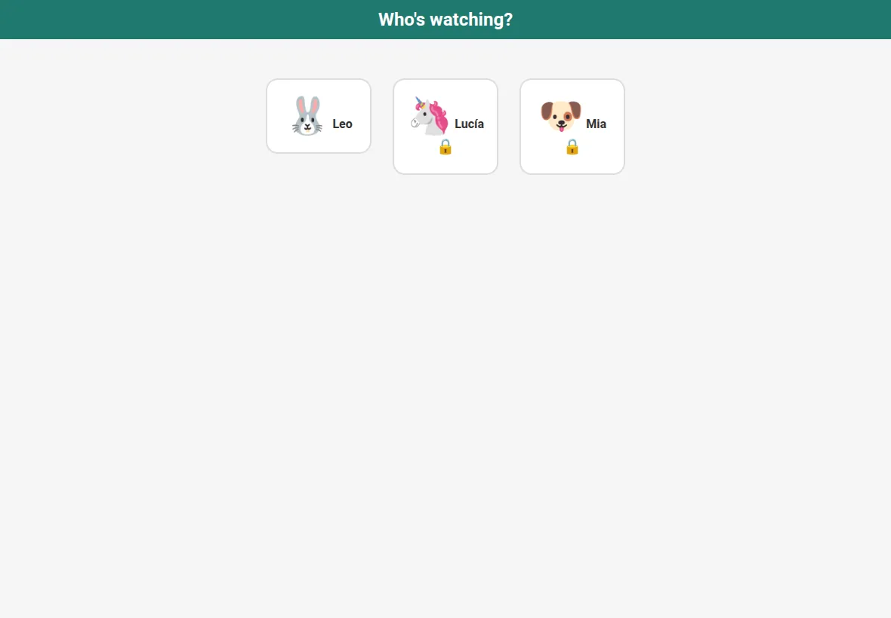
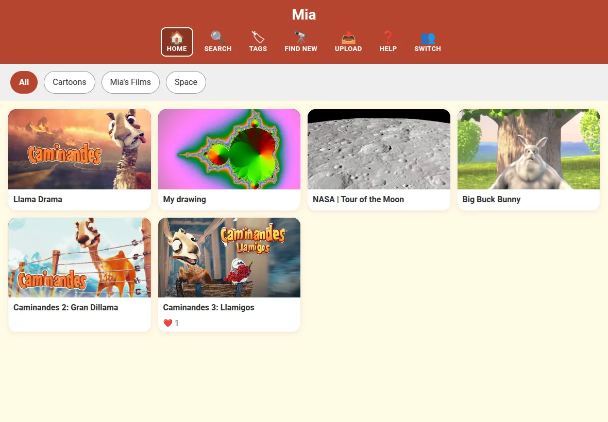
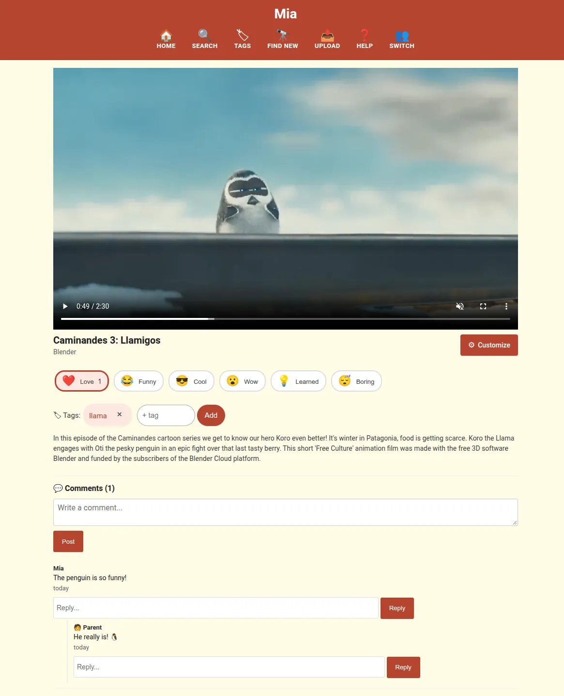
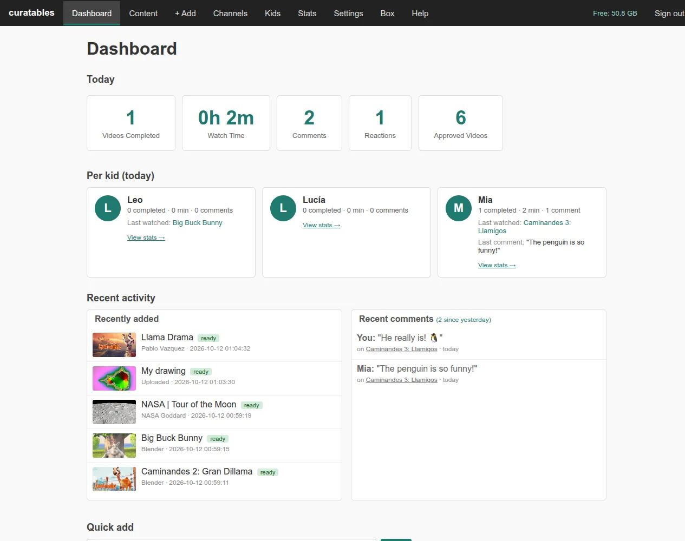
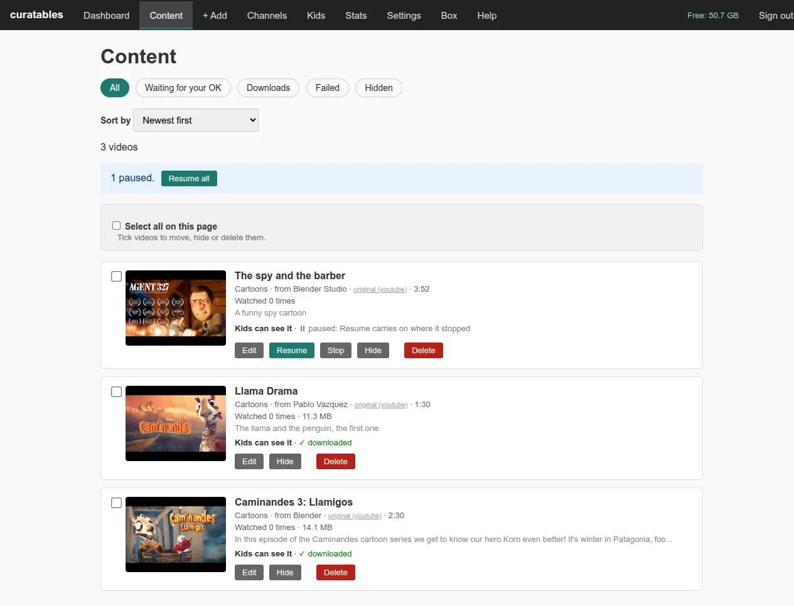
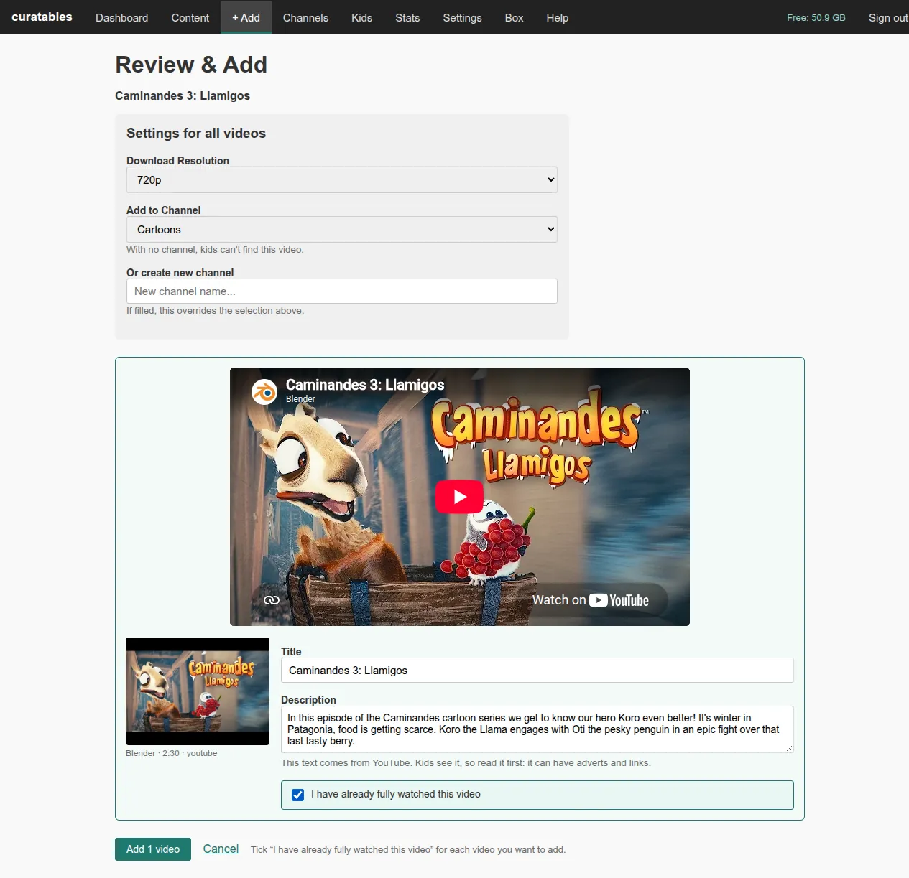
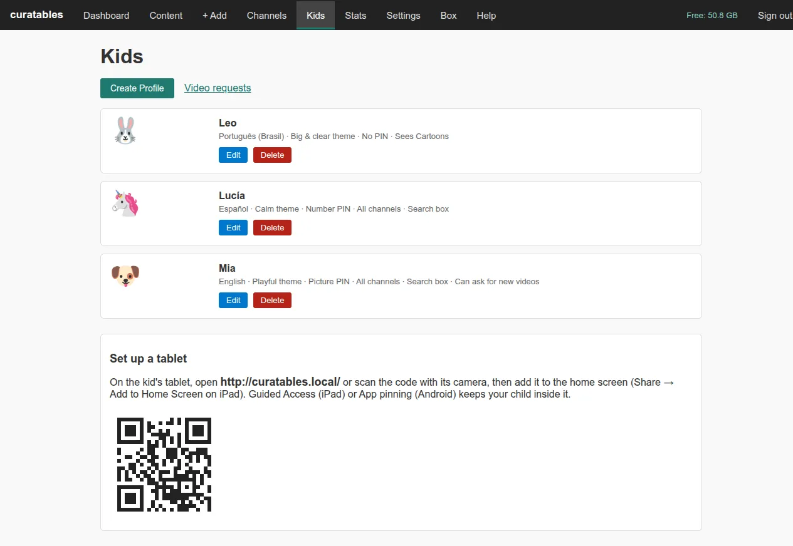
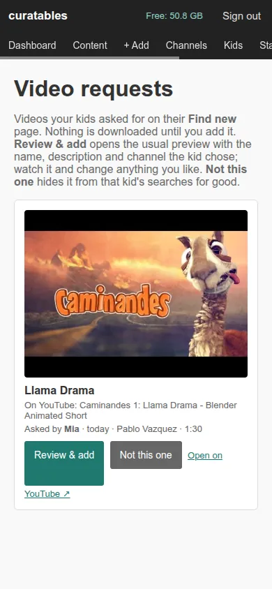
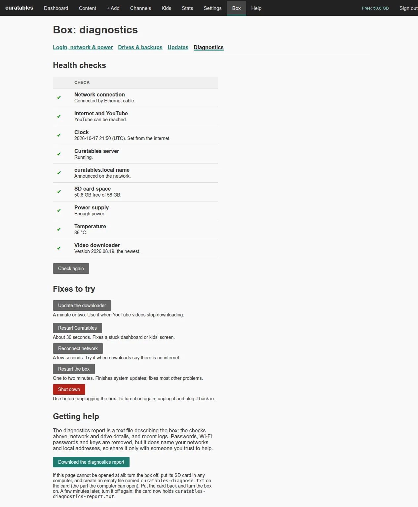

# curatables

Curatables is a small box you keep at home so your kids can watch **only
the videos you picked**. You add videos from YouTube or
[many other sites](https://github.com/yt-dlp/yt-dlp/blob/master/supportedsites.md);
the box saves them and plays them on any phone, tablet or laptop in the
house, with no ads, no suggestions, no autoplay and no links out to the
rest of the internet.

It was made for children who can't be handed the open internet, so the
kid screen is calm and simple, and each child's screen can be made
simpler still.

## What you need

- A **Raspberry Pi 4 or 5** (2 GB of memory or more). A Raspberry Pi is a
  small, cheap computer sold online and in electronics shops.
- Its **official power supply**. Phone chargers often aren't strong
  enough.
- A **microSD card** of 32 GB or more, and a way to plug it into your
  computer (a card slot or a cheap USB card reader).
- Optional: a **USB drive** for more videos, and a network cable to your
  router.

No Raspberry Pi? A spare laptop or mini-PC running Linux works too (see
[Other ways to install](#other-ways-to-install)).

## Set it up

You don't need to type any commands. The
[parents' guide](docs/parents-guide.md) explains every step in more
detail, for Windows, Mac and phone users.

1. **Download the image.** On the newest
   [release](https://github.com/MadeByTokens/curatables/releases/latest),
   under **Assets**, download `curatables-<version>-raspberry-pi.img.xz`
   (about 900 MB). This file is everything the box needs, ready-made; the
   other files are the source code. Don't unzip it.
   ([details](docs/parents-guide.md#1-put-curatables-on-the-sd-card))
2. **Write it to the SD card** with
   [Raspberry Pi Imager](https://www.raspberrypi.com/software/), a free
   program from the makers of the Raspberry Pi. Choose your Pi model,
   then **Use custom** and the file you downloaded, then your SD card.
   When Imager offers to customise the settings, you can say **No**:
   passwords and Wi-Fi are set later, and remote login (SSH) is off
   unless you turn it on.
   ([details](docs/parents-guide.md#1-put-curatables-on-the-sd-card))
3. **Connect it and switch it on.** Plug the box into your router with a
   cable, or write your Wi-Fi name and password in a small text file on
   the SD card. Then put the card in the Pi and plug in the power.
   ([details](docs/parents-guide.md#2-connect-the-box-to-your-network))
4. **Open http://curatables.local** in a browser on the same network,
   two or three minutes after switching on. If it doesn't open, see the
   [FAQ](docs/faq.md#getting-connected).
5. **Choose two passwords**: one for the parent dashboard, and a
   different one for the box itself. Do it within 30 minutes of
   switching on.
   ([details](docs/parents-guide.md#3-first-start-two-passwords))
6. **Add your first video.** Go to **+ Add**, paste a link, watch the
   video in the preview, tick that you've seen all of it and pick a
   channel (a "shelf" of videos). It downloads and gets ready to play.
   ([details](docs/parents-guide.md#your-first-video-and-your-first-kid))
7. **Give a kid their profile.** Go to **Kids → Create Profile**, pick a
   name and a picture, and choose what they may do. Then open the kid
   address on their tablet (the Kids page has a QR code to scan).
   ([details](docs/parents-guide.md#your-first-video-and-your-first-kid))

The dashboard's **Help** page has more tips. Wi-Fi, USB drives, backups
and updates are all on the dashboard's **Box** pages.

## How it keeps kids safe

A child only sees videos you watched and approved, only in the channels
you allow. Their tablet never talks to YouTube: everything plays from
your box. There is no search of the open internet unless you switch on
**Ask for new videos**, and even then nothing plays until you have
watched it and added it. Curatables can't stop a child leaving the
browser, so lock the tablet to it with Guided Access (iPad) or App
pinning (Android).

The full, plain-language explanation is in
[How Curatables keeps kids safe](docs/safety-model.md).

## What else it does

- **Rules for each child**: which channels they see, an optional PIN
  (numbers or three pictures), a language (English, Portuguese or
  Spanish), a theme (including a large-text, high-contrast one), and
  switches for reactions, comments, uploads, search and subtitles. New
  profiles start with "watch and react" only.
- **Ask for new videos** (off until you switch it on): a kid searches
  YouTube through the box, sees only results that pass your rules, and
  asks for one. You review it and add it, or say "not this one".
- **Bring in videos you already have** from a USB drive: movies, TV
  episodes, home videos.
- **Share a channel's list** with another family, and import theirs.
- **Looks after itself**: nightly backups of your settings and video
  list, a warning on the dashboard when the drive is getting full, and,
  on the Pi image, updates from the dashboard (with automatic security
  updates). Videos are kept until you delete them, unless you turn on
  **Freeing up space**.

## Screenshots

_From a real box with an example family and free films. The picture
guides for [parents](docs/guide/parents.md) and [kids](docs/guide/kids.md)
walk through every screen._

**Kid side**: calm, finite, picture-driven.

| Who's watching? | Home | Watching |
|:---:|:---:|:---:|
|  |  |  |

**Parent side**: everything that needs you, at a glance.

| Dashboard | Content library | Review & Add |
|:---:|:---:|:---:|
|  |  |  |
| Kids | A kid's request, on a phone | Box diagnostics |
|  |  |  |

## Other ways to install

- **A spare Linux laptop or mini-PC** (Debian or Ubuntu): follow
  [Getting started](docs/getting-started.md). You copy and paste a few
  commands; each one is explained.
- **Try it out first** on a Debian or Ubuntu computer you already have:
  [Getting started, steps 3 to 5](docs/getting-started.md#step-3--download-and-install-curatables).
  It runs only while its window is open.
- **For people comfortable with Linux**: [deployment.md](docs/deployment.md)
  (permanent install, port 80, external drives) and
  [pi-gen/README.md](pi-gen/README.md) (how the Pi image is built).

The box itself runs on Linux. Any phone, tablet or computer (iPad,
Android, Windows, Mac) can be used to watch and to manage it.

## Getting help

- The dashboard's **Help** page, and **Box → Diagnostics** on the Pi
  image, which checks the box and says what to do.
- The [FAQ](docs/faq.md) for everyday questions.
- [All the documentation](docs/README.md), sorted by who it's for.
- Found a bug or have an idea? Open a
  [GitHub issue](https://github.com/MadeByTokens/curatables/issues)
  (a free GitHub account is all it takes). Security problems go through
  [SECURITY.md](SECURITY.md) instead.

## Roadmap

Ideas being worked on or considered, not promises: smarter filtering of
kids' YouTube searches, a local AI helper that flags videos for you to
check, signing in to YouTube to avoid bot checks, and HTTPS. Design
notes are listed in [docs/README.md](docs/README.md#design-notes-future-work).

## Contributing

Help is welcome: fixing a typo, translating, testing on your hardware or
writing code. See [CONTRIBUTING.md](CONTRIBUTING.md). By taking part you
agree to the [Code of Conduct](CODE_OF_CONDUCT.md). What has changed
between versions is in [CHANGELOG.md](CHANGELOG.md).

## Thanks

Curatables downloads videos with [yt-dlp](https://github.com/yt-dlp/yt-dlp),
a free project kept alive by volunteers. If Curatables helps your family,
please consider
[sponsoring a yt-dlp maintainer](https://github.com/yt-dlp/yt-dlp/blob/master/Maintainers.md#maintainers).
Videos are converted with [FFmpeg](https://ffmpeg.org/). The maple-leaf icon is drawn from
[Noto Emoji](https://github.com/googlefonts/noto-emoji) (Apache-2.0).

## License

Licensed under the [Apache License, Version 2.0](LICENSE). Copyright 2026 Ricardo de Azambuja.
