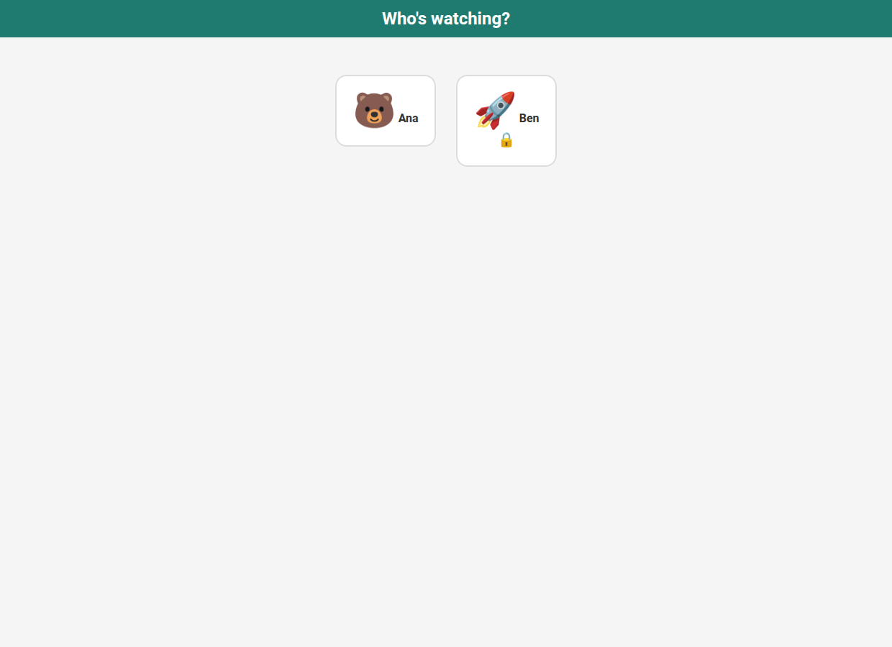
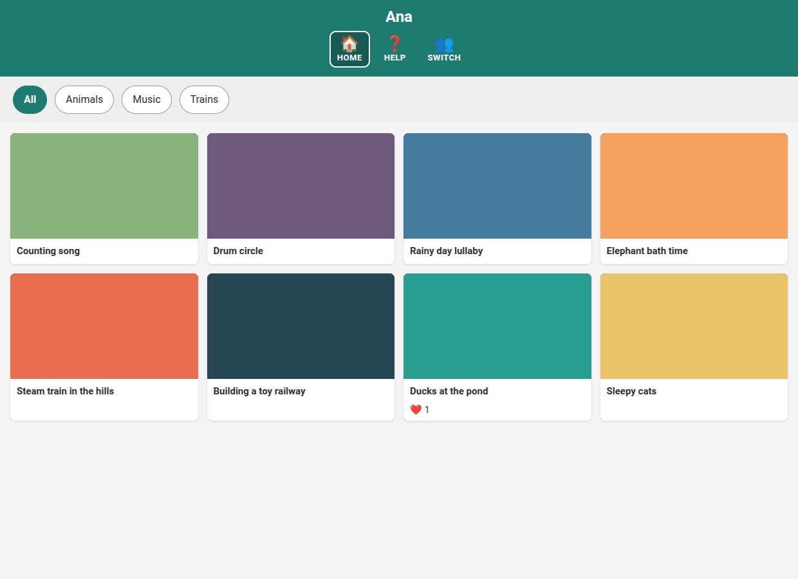
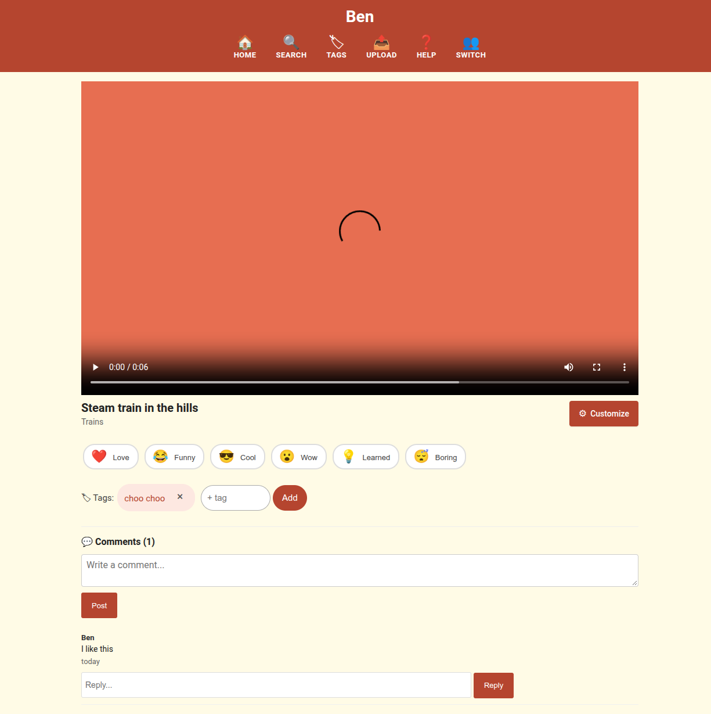
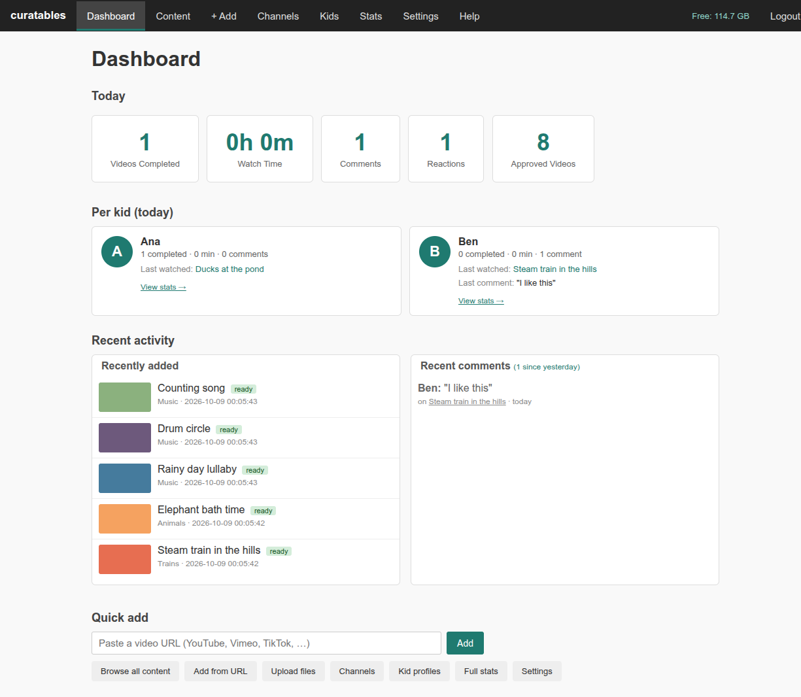
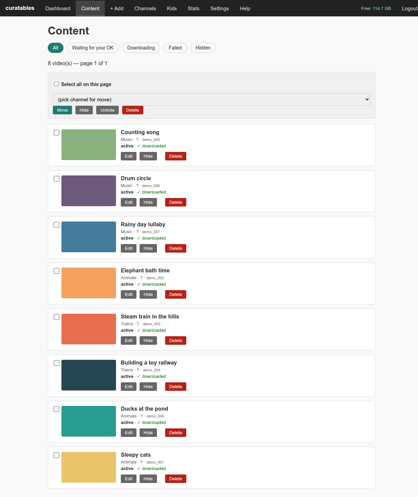
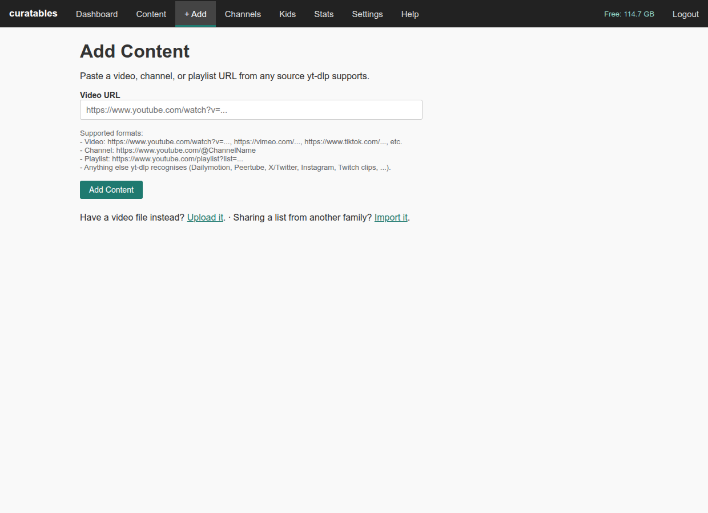
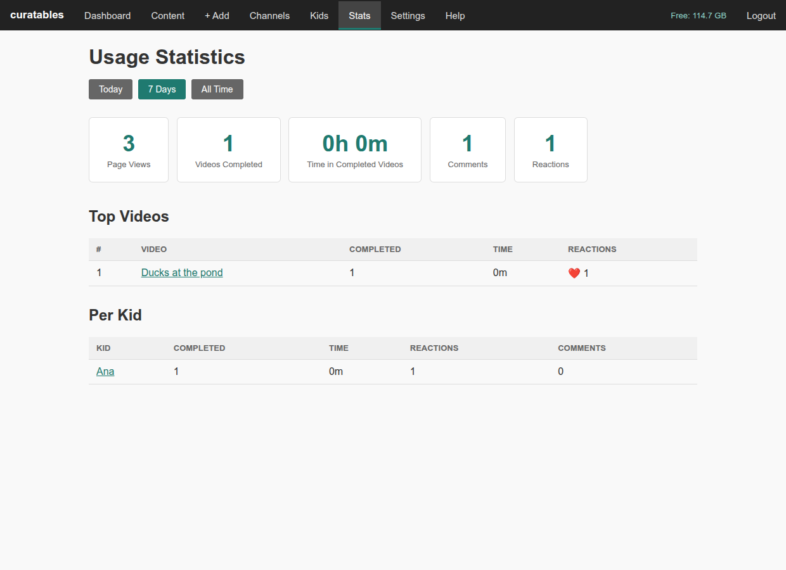
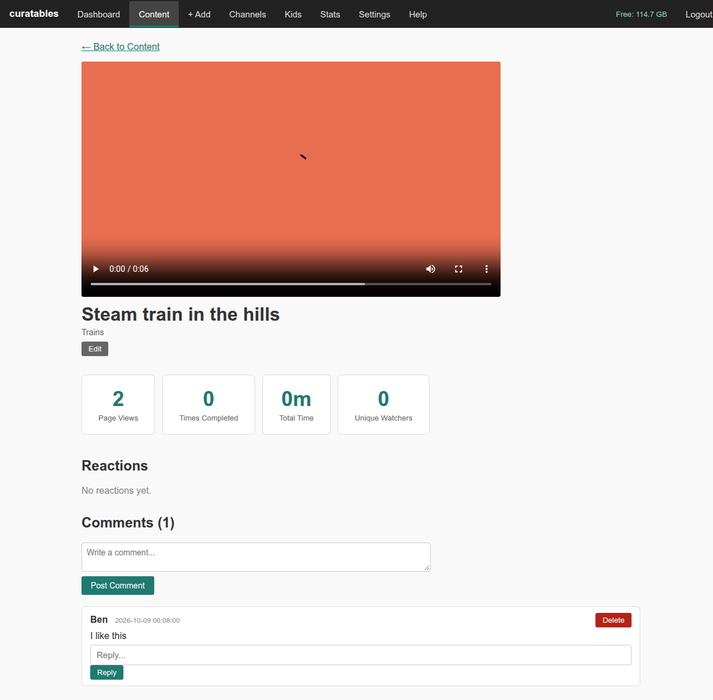
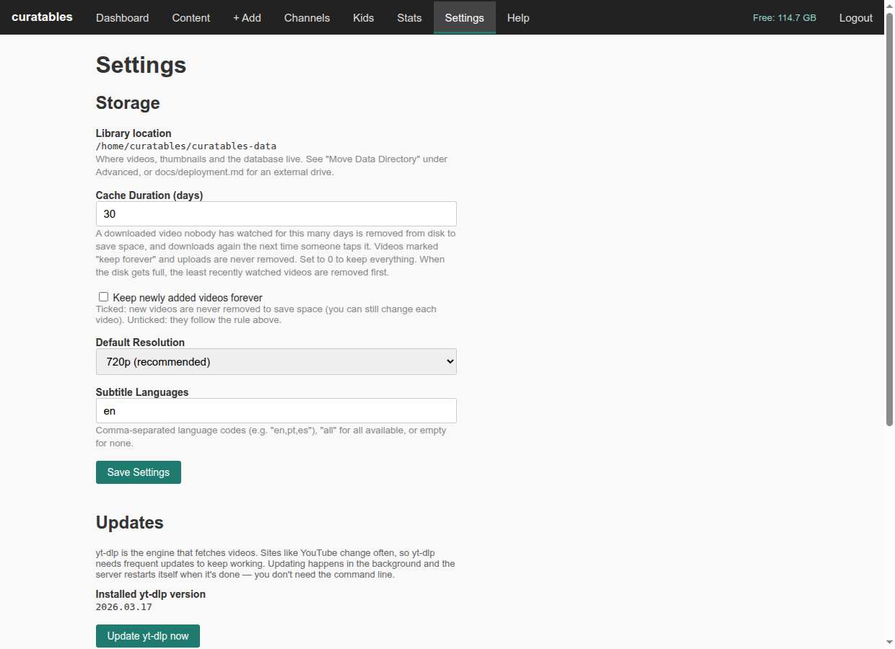

# curatables

A small server you run at home so your kids can watch **only the videos
you picked**: no ads, no recommendations, no autoplay, no way out to the
rest of the internet. You add videos from YouTube, Vimeo, Dailymotion,
TikTok, PeerTube, TED and [~1,800 other sites](https://github.com/yt-dlp/yt-dlp);
they are downloaded to your server and play from there on any phone,
tablet or laptop in the house.

It was built for children who can't be handed the open
internet, so the kid screen is deliberately calm and simple, and each
child's screen can be made simpler still.

## Get started

| You have… | Do this |
|---|---|
| A **Raspberry Pi 4 or 5** | Flash the ready-made image, boot, open `http://curatables.local`, set two passwords. Everything else (Wi-Fi, USB drives, backups, diagnostics) is in the dashboard: see the [parents' guide](docs/parents-guide.md), written for Windows, Mac and phone users. |
| A spare **Linux** laptop / mini-PC (Debian, Ubuntu) | Follow the [step-by-step guide](docs/getting-started.md), or run `sudo scripts/install.sh --systemd`. |
| Want to try it on your computer | `scripts/install.sh && .venv/bin/python run.py`, then open `http://localhost:8080/parent/`. |

New to all this? The [Getting started guide](docs/getting-started.md) is
written for parents who can copy and paste a command but aren't
developers. Then read [How Curatables keeps kids safe](docs/safety-model.md).

## How it works

1. You open the **parent dashboard** and paste a video, channel or
   playlist link.
2. You watch each video in the preview and tick that you've seen all of
   it; only then is it added.
3. The server downloads it and converts it to a format that plays on old
   devices too (H.264/AAC, up to 720p; an iPad from 2015 is fine).
4. Your kid opens `http://curatables.local/` on their tablet, taps their
   picture, and sees a grid of the videos you approved. Tap to play;
   when it ends: **Again** or **Home**.
5. You see what was watched, reactions and comments on the dashboard.

## Screenshots

_A demo library (generated test clips, no real data)._

**Kid side** — calm, finite, picture-driven.

| Who's watching? | Video grid | Watch page |
|:---:|:---:|:---:|
|  |  |  |

**Parent side** — glanceable triage.

| Dashboard | Content library | Add a video |
|:---:|:---:|:---:|
|  |  |  |
| Usage stats | Per-video detail | Settings |
|  |  |  |

## What it does

- **Curate** — add videos, whole channels or playlists by link; preview
  and approve each one; organise them into channels; share a channel's
  list with another family (`.ytc`, text or PDF) and import theirs.
- **Per-child rules** — each kid gets a profile with an avatar, optional
  PIN (digits or three pictures), language (English, Portuguese,
  Spanish), theme (including a large-text, high-contrast one), the channels
  they may see, and switches for reactions, comments, tags, customizing,
  uploads, search and subtitles. New profiles start with "watch + react".
- **Kid screen** — big picture buttons, an on-screen PIN pad, no ads, no
  autoplay, no recommendations, no links out; works back to Safari on
  iOS 9.
- **Kid uploads** — kids can add their own videos; ones sent to a shared
  channel wait for your approval.
- **Import from a drive** — bring in movies and videos already on a USB
  drive: titles and episodes guessed from the file names, pictures and
  descriptions looked up on Wikipedia (with the age rating), YouTube or a
  web page, TV shows grouped into one channel in episode order. Each
  conversion shows its live progress and time left, and can be cancelled
  at any moment without leaving anything behind.
- **Ask for new videos** (off by default) — a kid searches YouTube through
  the server, sees only results that pass your rules, and taps **Ask**;
  you review and add it, or say "not this one", from a requests inbox.
- **Parent dashboard** — "needs your attention" (failed downloads, kid
  uploads to approve, low disk), per-kid activity, stats, comments.
- **Looks after itself** — videos nobody watched for a while are removed
  to save space and come back when tapped (favourites can be kept
  forever); downloads queue one at a time; nightly backups; yt-dlp
  updates with one button; works with the library on a USB drive.

## Hardware

A **Raspberry Pi 4 (2 GB+) or Pi 5**, or any old laptop or mini-PC
running Debian/Ubuntu. Converting each new video is the only heavy job: a
Pi 5 or laptop does it quickly, a Pi 4 takes a few minutes per video.

On a Pi, keep the videos on a **USB hard drive or SSD**: SD cards are
small and wear out. `scripts/setup-external-drive.sh --media-only` puts
the videos on any exFAT, NTFS or ext4 drive (without formatting it, so a
drive that already holds your movies is fine) while the database stays on
the SD card, and makes Curatables wait for the drive at boot
([details](docs/deployment.md#media-on-an-external-drive-raspberry-pi--usb-disk)).
A 2.5" hard drive may need a powered USB hub on a Pi 4.

macOS, Windows, iOS and Android work as the devices you **watch** on;
the server itself runs on Linux.

## Documentation

- **Parents:** [parents' guide (Pi image)](docs/parents-guide.md) ·
  [getting started](docs/getting-started.md) ·
  [safety](docs/safety-model.md) · [FAQ](docs/faq.md) ·
  [backups](docs/backup.md) · [upgrading](docs/upgrade.md)
- **Running the server:** [deployment](docs/deployment.md) ·
  [Pi image](pi-gen/README.md) · [configuration](docs/configuration.md) ·
  [dependencies](docs/dependencies.md)
- **Contributors:** [CONTRIBUTING](CONTRIBUTING.md) ·
  [architecture](docs/architecture.md) · [threat model](docs/threat-model.md)
- Everything: [docs/README.md](docs/README.md). Changes: [CHANGELOG.md](CHANGELOG.md).

## Roadmap

- **Smarter wishlist filtering.** Kids can already ask for YouTube
  videos (see below); next is a local classifier for the search results,
  per [docs/design/filtered-search-and-proxy.md](docs/design/filtered-search-and-proxy.md).
- **AI safety helper (v0.6).** A local model that pre-screens videos
  against per-child criteria and flags or suggests, never decides
  silently. Design: [docs/design/v0.6-safety-agent.md](docs/design/v0.6-safety-agent.md).
- **Sign in to video sites (v0.7).** Pair a YouTube account from a phone
  so downloads stop hitting bot checks and age gates.
- **Later:** subscribe to another family's shared lists, HTTPS with a
  local certificate, the parent dashboard in other languages, Docker and
  NAS packages, offline web pages in the library
  ([idea](docs/design/offline-web-pages.md)).

## Contributing

See [CONTRIBUTING.md](CONTRIBUTING.md). Bug reports and feature requests
use the [issue templates](.github/ISSUE_TEMPLATE); security issues go
through [SECURITY.md](SECURITY.md). By participating you agree to the
[Code of Conduct](CODE_OF_CONDUCT.md).

## License

Licensed under the [Apache License, Version 2.0](LICENSE). Copyright 2026 Ricardo de Azambuja.
