# Curatables in pictures: for kids

A picture guide to the kids' screen, to look at together with your kid.
The captions are short, for reading aloud.

Each kid only sees the buttons a grown-up has switched on, so some of
these screens may not be on your kid's tablet. Making profiles and
switching things on is in the [guide for parents](parents.md). The
pictures come from a real box with three example kids, Mia, Leo and
Lucía. The videos are free films (see the
[credits](parents.md#credits)).

- [Who's watching?](#whos-watching)
- [Home](#home)
- [Watching a video](#watching-a-video)
- [Looking for a video](#looking-for-a-video)
- [Asking for a new video](#asking-for-a-new-video)
- [Your own videos](#your-own-videos)
- [Help](#help)
- [Other looks and languages](#other-looks-and-languages)

## Who's watching?

**Tap your picture.**

**Some kids have a secret.** Tap your three pictures in the right order.
Each one shows for a moment, then hides, so nobody else can see it.

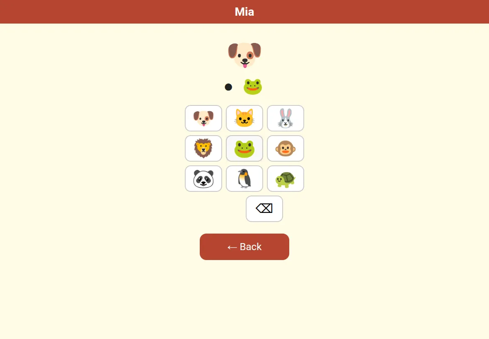

Or tap your numbers, then ✓. Got it wrong? Just try again.

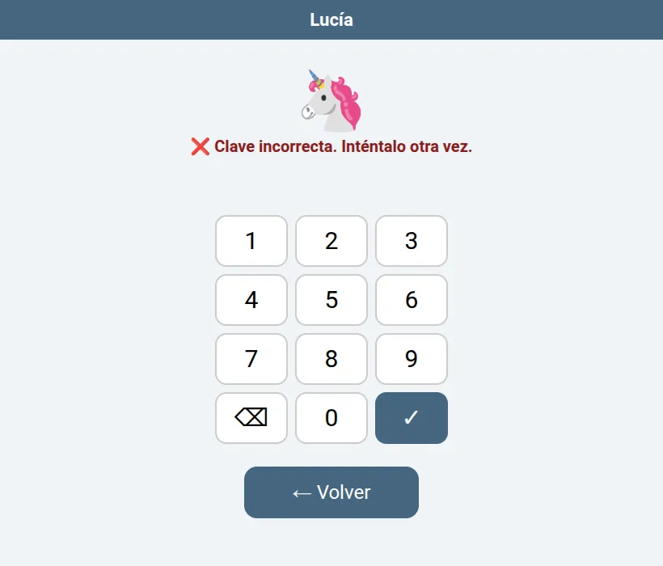

## Home

**Home is yours.** At first it shows your newest videos. **Tap a
picture to watch it.** A video marked "Takes a moment to start" has to
download first; it plays after a short wait. **All** shows every video,
and the channel buttons show one channel. **Home** always brings you
back.

**On a channel**, pick the order of its videos: **Newest**, **Oldest**,
**A to Z** or **Z to A**. The channel keeps that order for you. A to Z
goes by your own names for the videos, so naming them "1 Trains",
"2 Boats" puts them in the order you want.

**Change my Home** puts your favorite videos where you want them: tap a
**+** to put a video there, **Move** and then a spot to move one, or
**✕** to take one off. Tap **Done** when it looks right. Under a video,
**Put on my Home** adds it too.

## Watching a video

**Tap a face to say how you liked it.** **Download** keeps the video
on your tablet. Don't like it? **Hide** takes it away, and a grown-up
is told. You can put a word on the video
to find it again, and write a comment. A grown-up may write back.
**Change** under your comment fixes the words or deletes it.

**Stopped in the middle?** Next time, tap **Carry on** to go on from
there, or **From the start** to watch it all again.

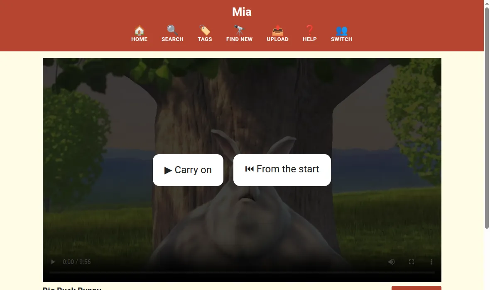

**At the end**, tap **Again** to watch it once more, or **Home** to pick
another one.

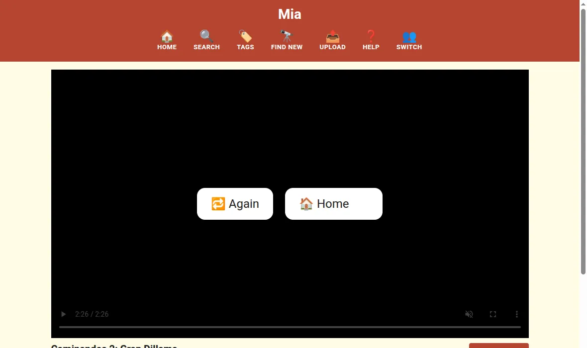

## Looking for a video

**Search** looks through your videos. Type a word and tap Search. If
no video has that word, it shows videos with a word that sounds like it
("dinasor" finds the dinosaurs) under "Did you mean one of these?".

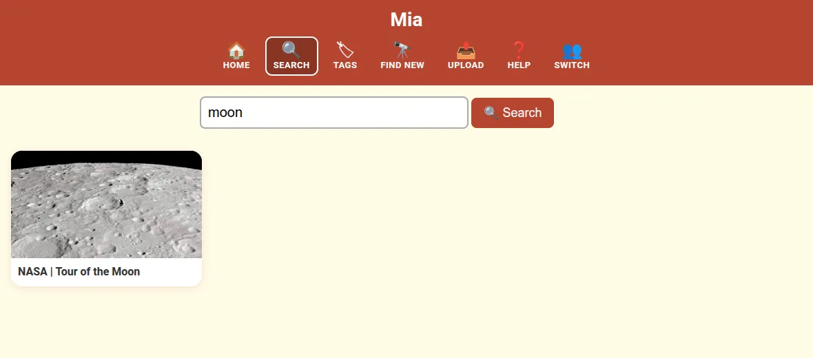

**Tags** shows the words you put on videos. Tap one to see its videos.

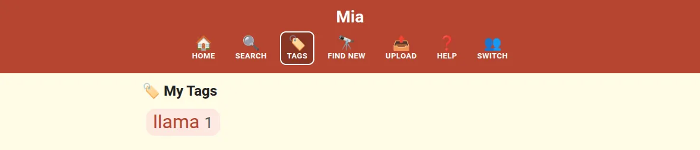

## Asking for a new video

**Find new** looks on YouTube. **Tap Ask** on a video you like. A
grown-up watches it first. "Already here" means you have it. Tap
**Channels** to look for a whole channel instead, then open one and tap
**More** to see more of its videos. The buttons above the results put
the best match, the newest or A to Z first.

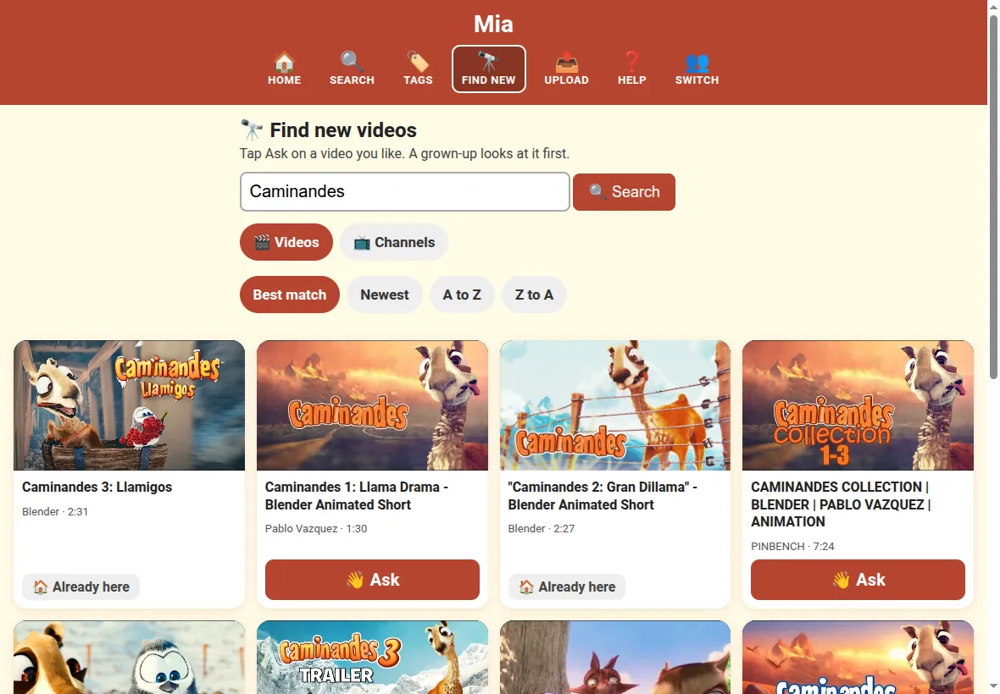

You can give it a name, say what it is about and pick a channel, or
type the name of a new channel to make one for it. Or just tap **Send**.
Tapped **Ask** by mistake? **Oops, don't ask** takes it back, and so does
**Don't ask** next to it in **What I asked for**.

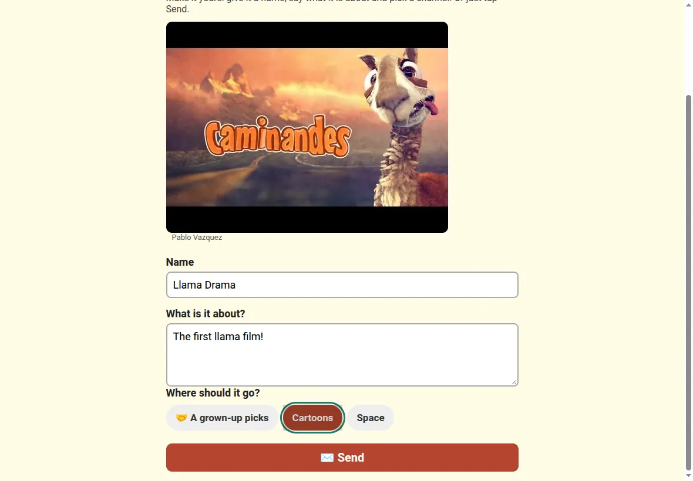

Sometimes a grown-up lets a video come straight away: then it says
**Yes! It is on its way**.

**What I asked for** shows how it's going. When a grown-up says yes, it
says **Yes! Watch**. **Can't get this one** means YouTube won't let the
box have it.

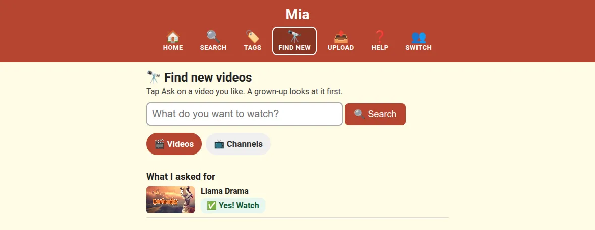

## Your own videos

**Upload** sends a video from the tablet. You can make your own channel
for it first. A video for your own channel is there straight away; one
for another channel waits for a grown-up. **What I sent** shows how each
one is going; **Don't send** takes back one that is still waiting.
Picked the wrong video? **Stop** while it is sending keeps your title
and channel, so you can pick another one. If the box already has that video, it opens it for you.

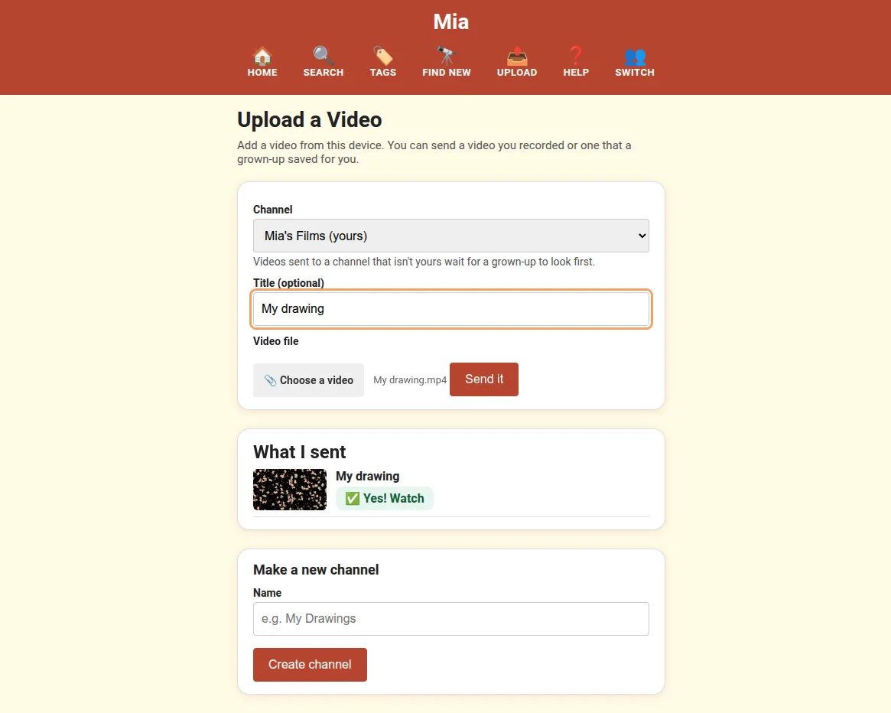

**Customize** on a video gives it your own name, words and picture. Only
you see them. Tick your channels to put the video in them, or type a name
to make a new channel with it. On your own channel, the pencil lets you
rename it or **Delete this channel**. Videos you uploaded to it go to a
grown-up.

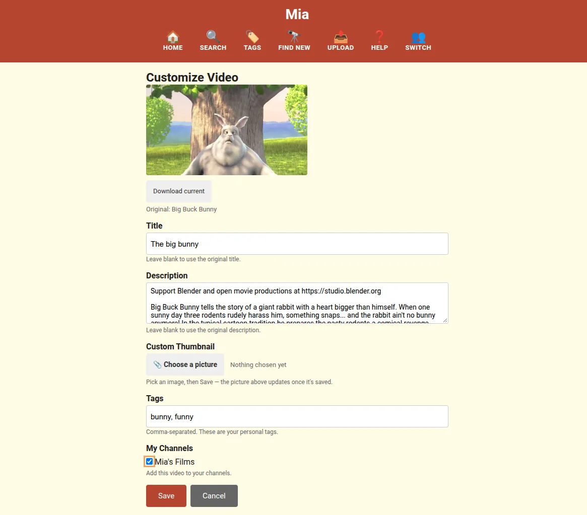

## Help

**Lost? Tap Help.** It shows what each button does. Home always takes you
back to the start.

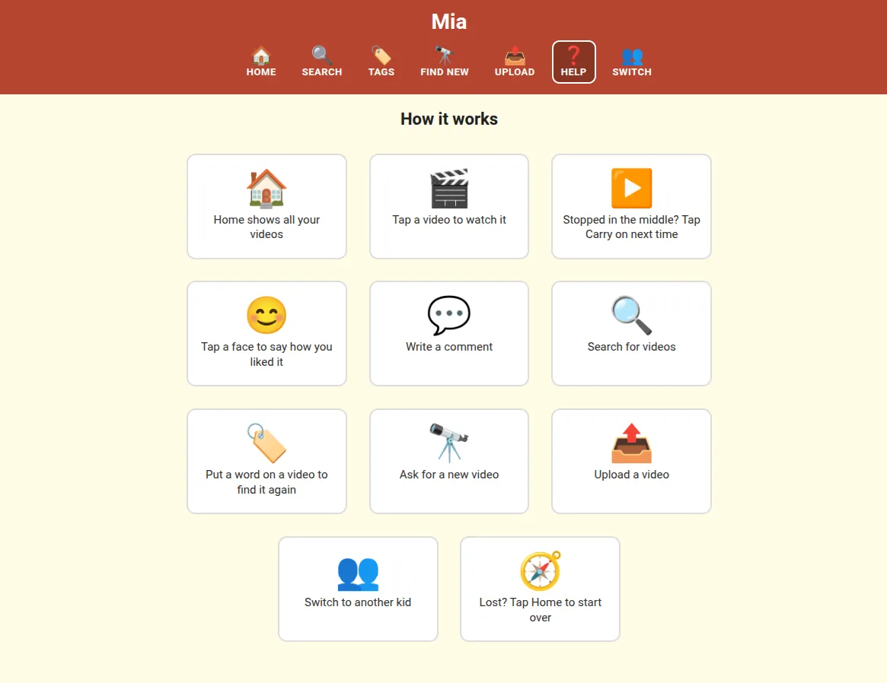

## Other looks and languages

A grown-up can choose a different look and language for each kid. Leo's
phone has the **Big & clear** look in Portuguese and only shows him
cartoons.

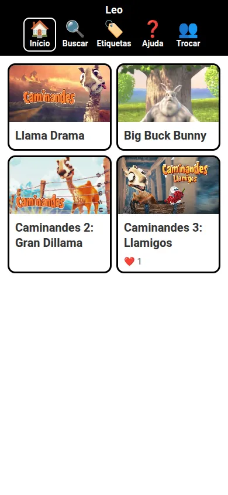

Lucía's tablet has the **Calm** look in Spanish.

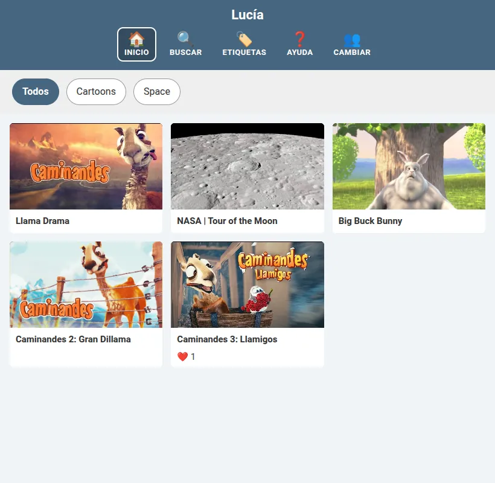
