# Curatables in pictures: for parents

This is the everyday side of Curatables, one screen at a time: adding
videos, making a profile for each kid, answering their requests and
looking after the box. Putting Curatables on the SD card and the first
start are in the [parents' guide](../parents-guide.md); this guide
picks up once you have set the two passwords.

The pictures come from a real box with an example family: **Sam**, the
parent, and three kids, **Mia**, **Leo** and **Lucía**. The kids' side
has [its own guide](kids.md), to look at together with your kids. The
videos are free films; see [the credits](#credits).

- [1. Sign in](#1-sign-in)
- [2. Make a channel](#2-make-a-channel)
- [3. Add a video](#3-add-a-video)
- [4. Make a profile for each kid](#4-make-a-profile-for-each-kid)
- [5. Your kids ask for a video](#5-your-kids-ask-for-a-video)
- [6. Day to day](#6-day-to-day)
- [7. Settings](#7-settings)
- [8. Looking after the box](#8-looking-after-the-box)
- [Credits](#credits)

## 1. Sign in

Open **http://curatables.local/parent/** on a computer, phone or tablet on
the same network as the box, and type the parent dashboard password.
Signing in on one device doesn't sign you out on another.

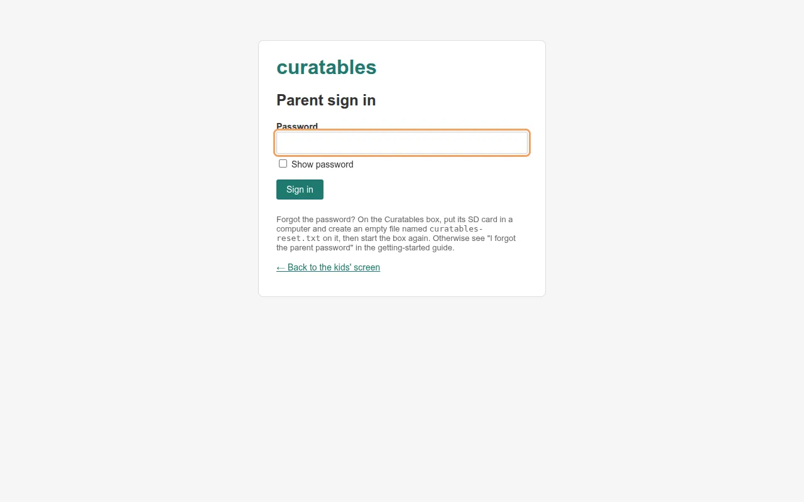

The first time, the dashboard shows a short list of what to do. The QR
code opens the kids' screen on a tablet's camera.

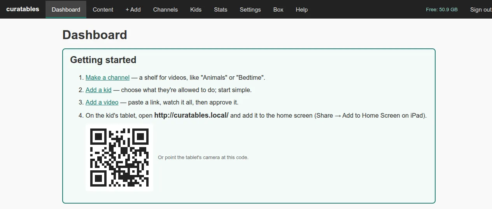

## 2. Make a channel

A channel is a shelf of videos, like "Animals" or "Bedtime". Kids only
see videos that are in a channel, and you choose which channels each kid
sees. Open **Channels**, type a name (and, if you like, a few words
about it) and press **Create**.

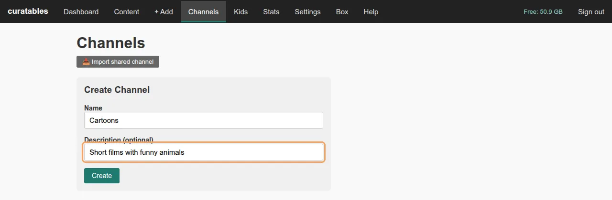

Sam made two: **Cartoons** and **Space**.

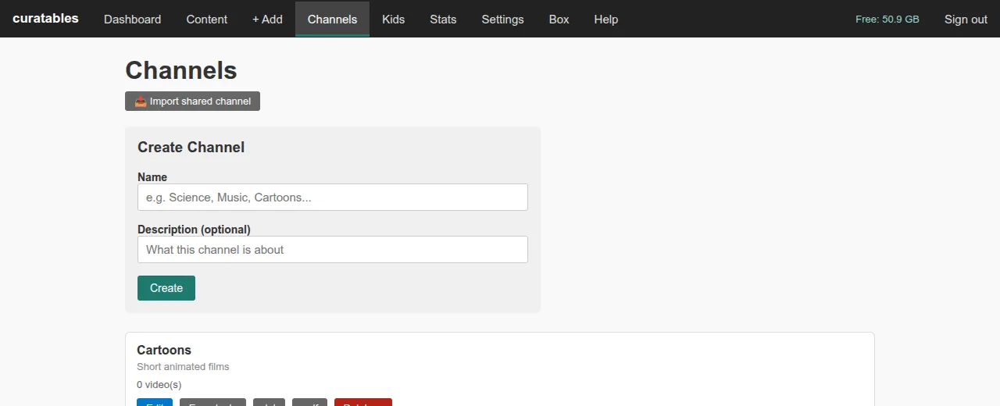

## 3. Add a video

Open **+ Add** and paste a link: one video, a whole YouTube channel or a
playlist. Press **Add Content**. Looking it up takes a few seconds.

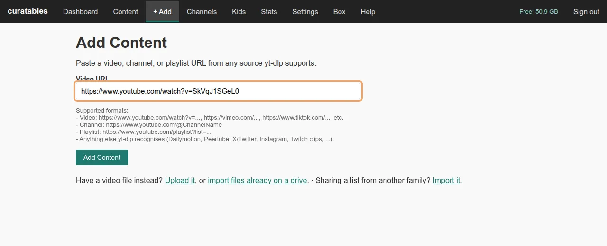

**Review & Add** shows the video so you can watch it before any kid
does.

1. Pick its **channel**. With no channel, kids can't find it.
2. Change the **title** if you like, and read the **description**. It
   comes from YouTube and kids see it, so take out anything you don't
   want them to read, such as links or adverts. The page reminds you.
3. Watch it, then tick **I have already fully watched this video**.
   **Add** stays grey until you do.

The video then downloads in the background. On a Raspberry Pi 4 a short
cartoon is ready in a minute or two.

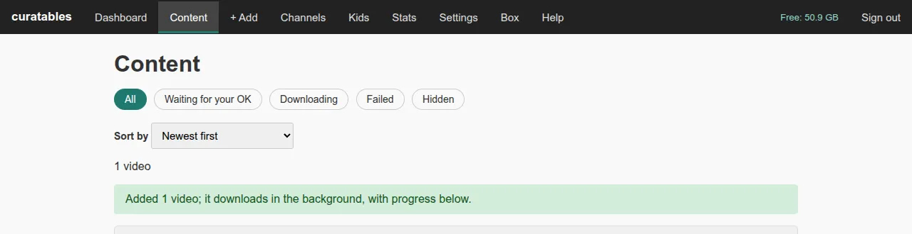

**Content** lists every video with how its download is going. The tabs
along the top show only those still waiting for your OK, still
downloading, failed or hidden. **Sort by** puts the least watched, the
ones not watched for longest or the largest files first; each video
shows how often it was played, when it was last watched and its size.
Tick some to move, hide or delete them, or press **Free up files** to
make room: their files go, but they stay on the kids' screens, marked
"Takes a moment to start", and download again when a kid taps them.

**Edit** on a video changes its title, description, picture or channel.
Sam shortened YouTube's long title to "Caminandes 2: Gran Dillama".

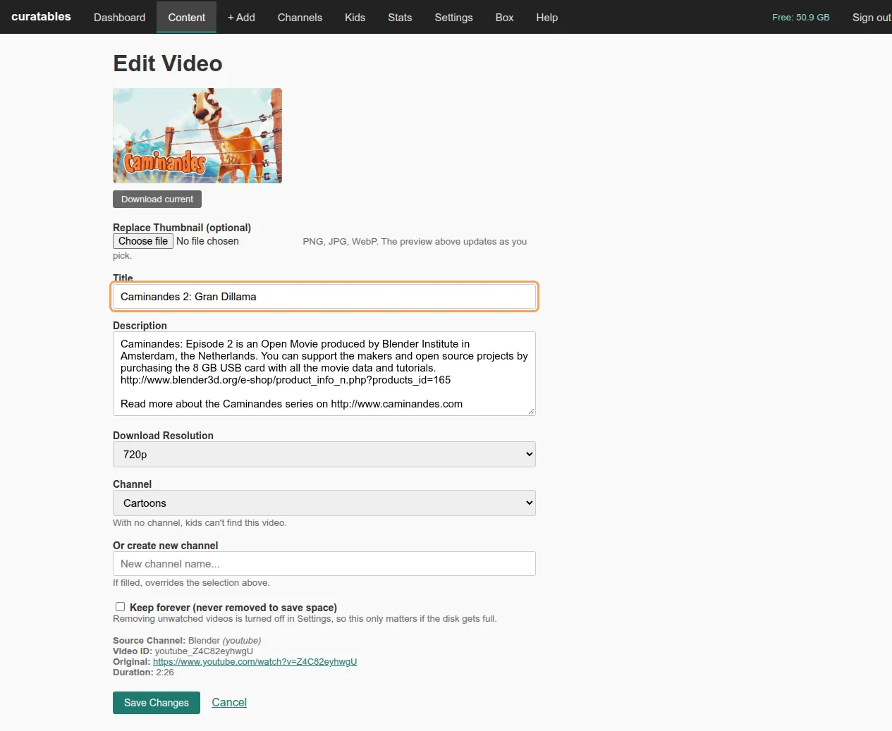

## 4. Make a profile for each kid

Open **Kids → Add a kid**. Give the kid a name and a picture, then
choose:

- **A PIN**, if you want one: four to six numbers, or three pictures for a
  kid who doesn't read numbers yet. Leave it empty for no PIN.
- **Language** and **theme**: Default, Playful, Calm, or Big & clear
  (larger text, stronger colours).
- **What they may do.** A new profile can watch and react, nothing more.
  Tick more when you're ready: a search box, comments, tags, their own
  channels and uploads, asking for new videos, or subtitles that turn on
  by themselves.
- **Which channels they see**: all of them, only the ones you tick, or
  none of yours (only channels they make themselves).

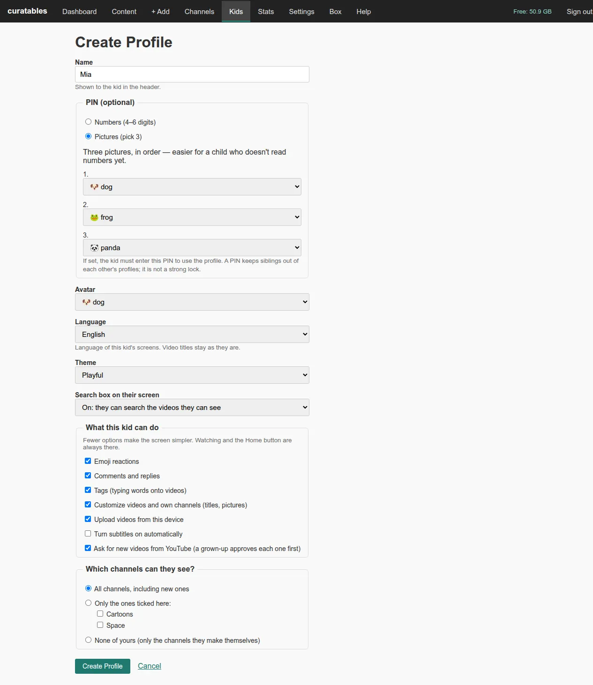

The **Kids** page sums up each profile. Mia has everything switched on,
Leo has the Portuguese Big & clear screen and sees only Cartoons, and
Lucía has the Spanish Calm screen with a number PIN.

**Set up the tablet:** on the kid's tablet, open **http://curatables.local/**
(or scan the QR code on this page with its camera) and add it to the
home screen (on an iPad, use Safari; see the
[FAQ](../faq.md#getting-connected)). To keep your kid inside it, use Guided Access on an iPad
or App pinning on Android; see the
[safety model](../safety-model.md#what-you-still-need-to-do-on-the-device).

## 5. Your kids ask for a video

A kid with **Ask for new videos** switched on can look for videos on
YouTube and ask for one. Nothing is downloaded until you add it. The
dashboard puts requests at the top, under **Needs your attention**.
Each request shows the name and note your kid wrote, the channel they
picked ("For: Cartoons") and YouTube's own title. Everything here works
on your phone too.

**Review & add** opens the same Review & Add page as before, already
filled in with the name, description and channel your kid chose. Watch
it, change anything you like and add it. Your kid's request then says
**Yes! Watch**. **Not this one** turns it down, and that kid won't see
it in their searches again; **Let (name) ask again** under **Recently
decided** takes that back. **Remove** just drops a request (one tapped by
mistake, say), and your kid can ask for it again later. A kid who can
make their own channels (**Customize videos and own channels**) can make
one for the video when asking; any other kid can only suggest a name,
and you see it as "For: a new channel" and filled in under **Or create
new channel**. Your kid can also take back a request before you decide.
The page lists the oldest 100 requests
waiting (and says how many more there are), with your 20 latest
decisions below. If YouTube won't serve a video (it was removed or is
age-restricted), the request says so and your kid sees "Can't get this
one".

**Comments:** when a kid writes a comment, open the video from the
dashboard or **Content** to read it, reply or delete it. Your reply
shows to the kid as coming from "Parent".

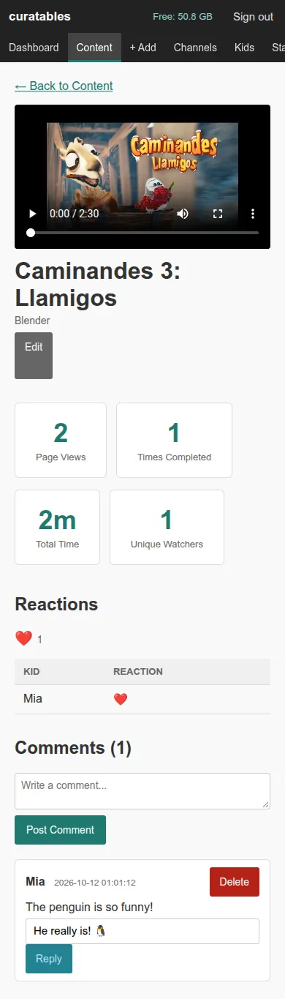

## 6. Day to day

The **dashboard** shows today at a glance: what each kid watched, new
comments and reactions, what was added (and by whom: a kid's upload
says "Uploaded by Mia · in Mia's Films"), and anything that needs you
(requests, failed downloads, a drive that's getting full).

It works the same way on a phone.

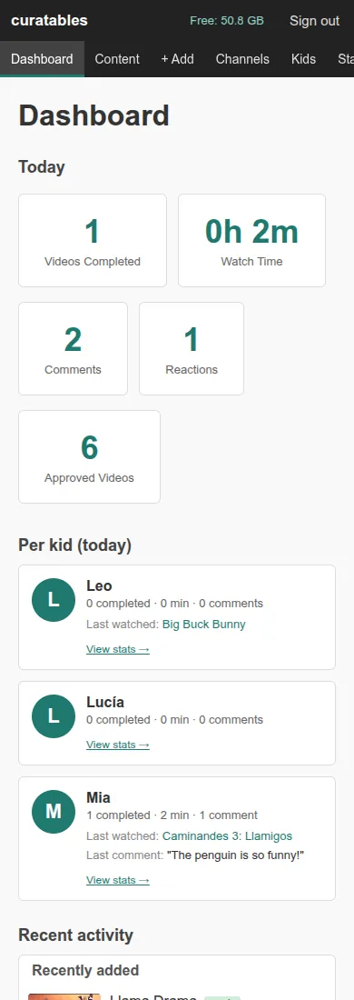

**Stats** adds up what was watched today, in the last 7 days or ever,
for each video and each kid.

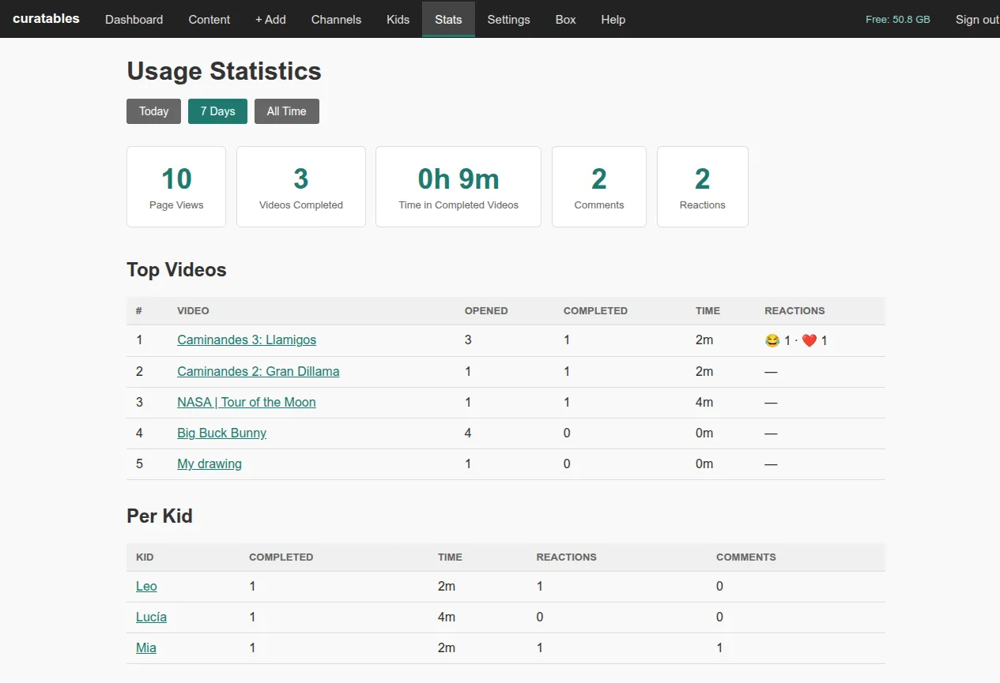

## 7. Settings

**Settings** holds the choices for the whole box: storage and picture
quality, the family's time zone (where "today" starts in the stats),
freeing up space when the disk gets full, updates, the rules for video
requests, importing from a drive, and your parent password.
Most families never need to change them.

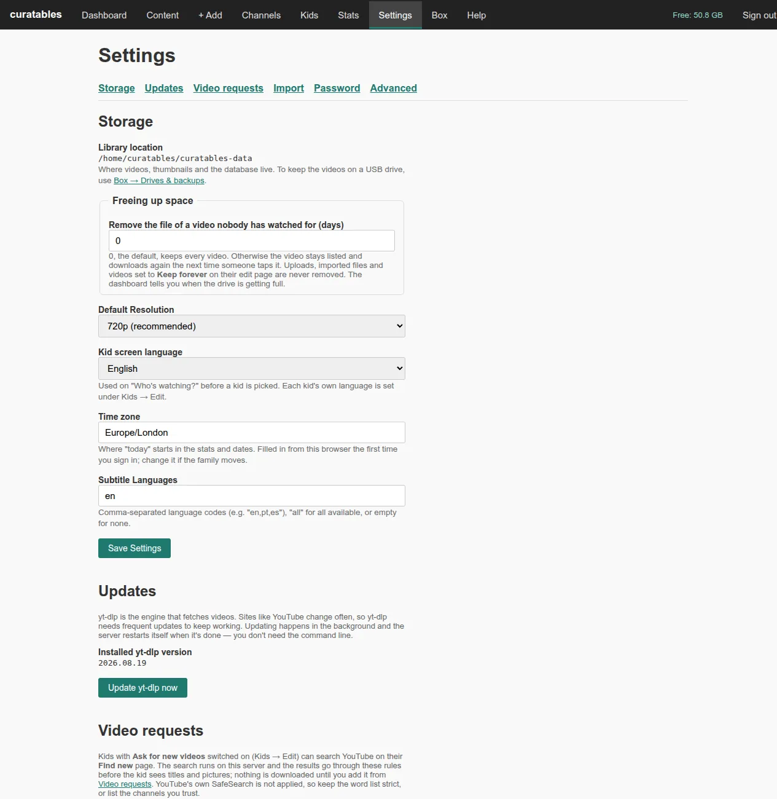

## 8. Looking after the box

**Box** in the menu looks after the box itself, on four pages. USB
drives are covered in the
[parents' guide](../parents-guide.md#5-usb-drives-for-more-videos).

**Login, network & power** shows how the box is connected, and is where
you:

- **Switch Wi-Fi.** Press **Look for networks**, then **Use this** next
  to yours, type its password and press **Switch Wi-Fi**. The box tries
  the new network first and goes back to the old one if it can't
  connect, so a typo can't lock you out. If you're on Wi-Fi yourself,
  the page may drop for a moment.
- **Change the Linux login password** or **turn SSH on or off**. Both ask
  for your parent password again.
- **Restart Curatables**, **Reconnect network** or **Restart the box**.
  Restarting fixes most "it's stuck" moments.
- **Shut down** the box before unplugging it. Unplug once the green light
  stops flickering (about 20 seconds); to turn it on again, unplug it for
  a few seconds and plug it back in.

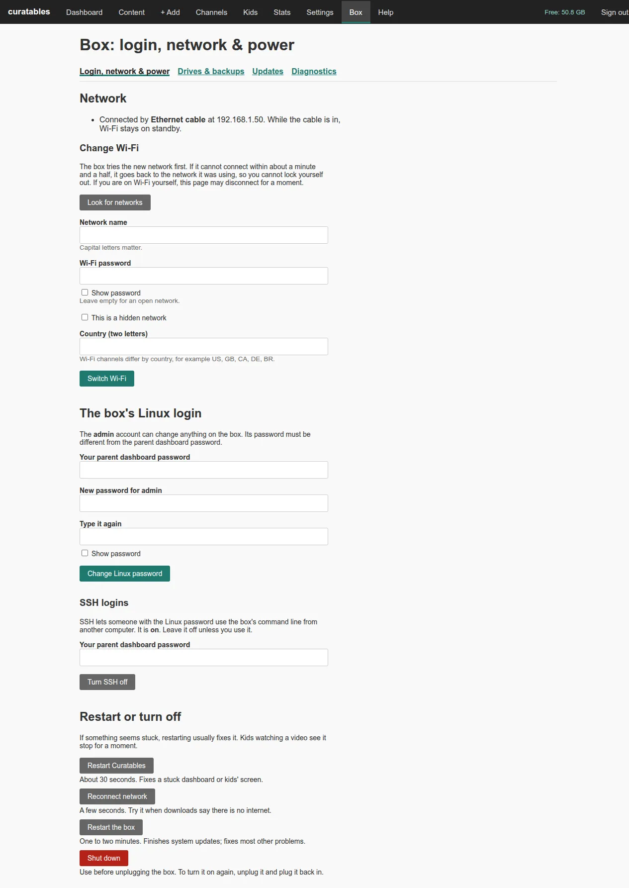

**Restart the box** asks first, then the page waits and comes back by
itself, usually within a minute. Kids' tablets stay in their profiles.

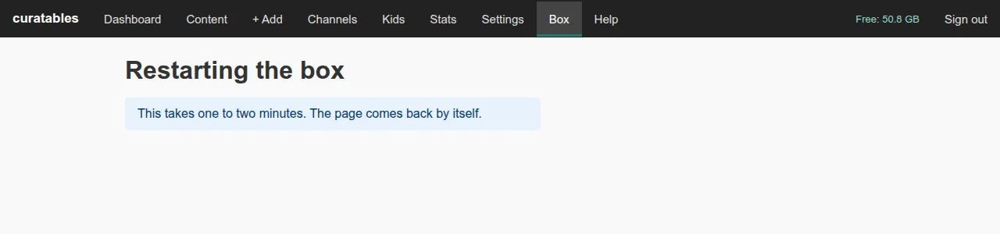

**Drives & backups** is where you add a USB drive for more videos. The
box also saves its settings, profiles and video list every night.
**Back up now** saves one straight away, and **Restore** puts a backup
back, after asking.

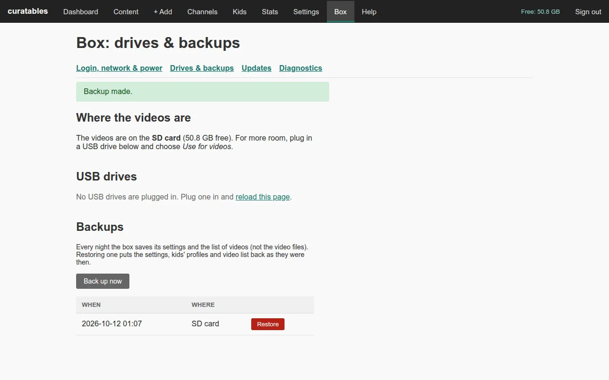

**Updates** keeps the box current without touching the SD card:

- **Update to …** installs a new Curatables version from GitHub, keeping
  every video, kid and setting. The new version is prepared while the old
  one keeps running, so kids only lose about a minute. If it doesn't
  start, the box goes back to the old one by itself, and **Go back to …**
  undoes an update you don't like.
- **Update the downloader** when YouTube videos stop downloading.
- **Update system packages** installs the operating system's updates.
  Security updates also install by themselves every day. If the page
  says a restart is needed, restart the box when nobody is watching.

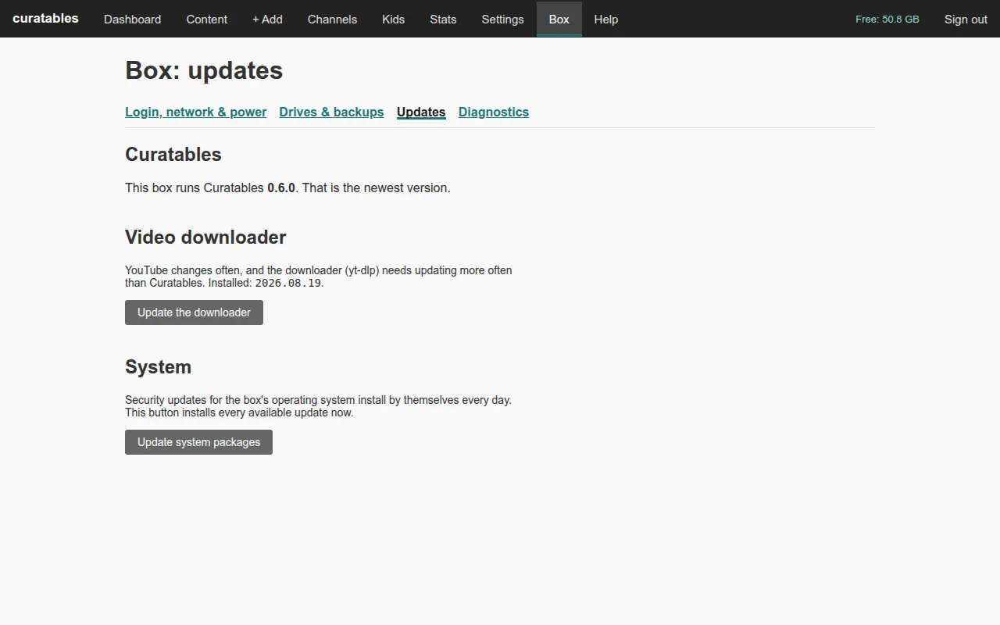

**Diagnostics** checks the box and says what to do about anything that
isn't right. **Download the diagnostics report** saves a text file you
can send to someone helping you; it leaves out passwords and keys.

If something's wrong, the [parents' guide](../parents-guide.md#7-somethings-wrong)
and the [FAQ](../faq.md) list the usual fixes.

## Credits

The videos in these pictures are free films, used under their licences:

- *Caminandes 1: Llama Drama*, *Caminandes 2: Gran Dillama* and
  *Caminandes 3: Llamigos* by Pablo Vazquez and the Blender Institute,
  [Creative Commons Attribution](https://creativecommons.org/licenses/by/4.0/).
- *Big Buck Bunny* by the Blender Foundation,
  [CC BY 3.0](https://creativecommons.org/licenses/by/3.0/).
- *NASA | Tour of the Moon* by NASA's Goddard Space Flight Center.
- *Agent 327: Operation Barbershop* by Blender Animation Studio,
  [CC BY 4.0](https://creativecommons.org/licenses/by/4.0/) (its picture only, in the kids' guide).

The family is made up.
